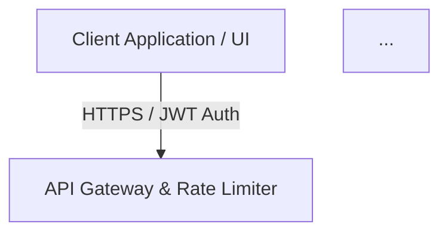

# Tutorial 4: System Design y dominio de STAR — el repertorio completo de entrevista

> Versión en español del documento original en inglés: [04-system-design-star-mastery.md](../04-system-design-star-mastery.md)

> Para quién es: ingenieros que ya pueden construir pipelines RAG (Tutoriales 1-3) y ahora
> necesitan *narrar* una arquitectura de producción bajo presión de tiempo, y luego
> sobrevivir a la ronda comportamental con respuestas STAR disciplinadas. Presupuesto de
> tiempo: 90 minutos, de los cuales 30 son hablados en voz alta.

## Lo que vas a dominar

1. El marco de system design de 45 minutos contra el que los entrevistadores te puntúan
   implícitamente.
2. Una respuesta completa y trabajada para la pregunta insignia: "Diseña un Clinical Analysis
   Copilot que maneje 10,000 requests/seg con cero fuga de PII" — construida directamente
   sobre `docs/architecture.md`.
3. Aritmética de capacidad y costo con los helpers de costo del repo, para que tus
   estimaciones sean números, no adjetivos.
4. Un drill STAR con cronómetro contra el entrevistador simulado interactivo (`make mock`).

## Paso 1: Prepara el entorno

```bash
python -m venv .venv
source .venv/bin/activate        # Windows: .venv\Scripts\activate
pip install -e ".[dev]"
cat docs/architecture.md
```

Salida esperada: el diagrama mermaid y el encabezado de la referencia de arquitectura
(abreviado aquí):

```text
# Enterprise AI Architecture & RAG Pipeline

> Visual reference for System Design interviews: End-to-End Healthcare RAG & MLOps Platform.



**Variante de Google Colab:** la lectura de arquitectura y la aritmética de costos
funcionan en Colab tras la celda habitual (`%cd /content/vecanova-ai-interview-prep` y
`!pip install -e ".[dev]"`). El drill de entrevista simulada (Paso 6) es una experiencia
de terminal — corrígelo localmente, o en Colab con el truco de input canalizado que se
muestra ahí.

## Paso 2: Interioriza la arquitectura de referencia

Lee `docs/architecture.md` hasta que puedas redibujarla de memoria. Es un pipeline de seis
etapas; memoriza las etapas, no las cajas:

| Etapa | Componentes del diagrama | Responsabilidad en una línea |
|---|---|---|
| 1. Edge | Cliente, API Gateway, rate limiter | Autenticar (JWT), estrangular, moldear tráfico |
| 2. Protect | Sanitizador PII/PHI (Presidio/regex) | Enmascarar identificadores antes de que cualquier modelo vea texto |
| 3. Orchestrate | DAG multi-agente LangGraph | Enrutar tareas, sostener estado, llamar tools |
| 4. Retrieve | Retriever híbrido (denso + BM25), vector DB, reranker cross-encoder | Traer y rankear los pocos chunks que importan |
| 5. Generate + Guard | Foundation model (VPC privado / SageMaker), guardrails de salida | Producir una respuesta fundamentada y conforme a política |
| 6. Observe | Evaluación RAGAS, tracing con Langfuse | Puntuar calidad, trazar latencia/costo, alimentar puertas de CI |

Esta tabla *es* tu esqueleto de whiteboard. Cada respuesta de system design que des en este
dominio debería dibujar estas seis etapas dentro de los primeros cinco minutos, y luego
hacer deep dive donde el entrevistador empuje.

## Paso 3: Requisitos y matemática de capacidad (minutos 0-10 de la entrevista real)

Declara los supuestos en voz alta, luego fíjalos con aritmética. Los helpers de costo del
repo lo hacen exacto:

```python
from interview_prep.cost import estimate_tokens, estimate_cost, monthly_projection

system_prompt = "System: You are a clinical decision-support assistant for hospital care teams. Answer from the provided context."
user_prompt = "Patient context: 67-year-old, systolic 182, anomaly score 1.73. Draft a care-team alert."
response_text = "Escalate to the on-call team; recheck blood pressure in 15 minutes; document in the EHR."

tokens_in = estimate_tokens(system_prompt) + estimate_tokens(user_prompt)
tokens_out = estimate_tokens(response_text)
print(tokens_in, tokens_out)

cost_per_request = estimate_cost(
    tokens_in=tokens_in,
    tokens_out=tokens_out,
    price_in_per_mtok=1.50,     # frontier managed API, USD per million tokens
    price_out_per_mtok=6.00,
)
print(cost_per_request)
print(monthly_projection(requests_per_day=50_000_000, cost_per_request=cost_per_request))
```

Salida esperada (los conteos de tokens se siguen de los strings exactos de arriba a 4
caracteres por token):

```text
50 22
0.000207
310500.0
```

Ahora di los números como el entrevistador espera escucharlos: 10,000 requests por segundo
en pico son 864 millones de requests por día si se sostiene; incluso a un promedio más
realista de 50 millones de requests por día, una API administrada frontier a $0.000207 por
request cuesta unos $310,500 al mes. Reduce los tokens a la mitad y reduces la factura a la
mitad; cambia a un modelo más pequeño a una décima parte del precio y la proyección baja a
unos $31,050 — esa razón es todo el trade-off de API administrada contra self-hosted,
cuantificado en una línea.

## Paso 4: La respuesta trabajada (minutos 10-35)

Entrégala en este orden. Los números de etapa entre corchetes referencian la tabla del
Paso 2.

**Encuadre (30 segundos).** "Voy a confirmar requisitos, dimensionar el sistema, bosquejar
el pipeline de alto nivel, y luego hacer deep dive en retrieval, manejo de PII y modos de
fallo."

**Requisitos (2 minutos).** Funcionales: clínicos hacen preguntas sobre notas clínicas y
reciben respuestas fundamentadas y citadas con alertas al equipo de cuidado. No
funcionales: cero egreso de PII (HIPAA), latencia p95 bajo 2 segundos end-to-end,
disponibilidad de 99.9%, trazas de auditoría completas por siete años.

**Alto nivel (5 minutos).** Dibuja las seis etapas. Nombra cada componente y su contrato:
el gateway termina la auth JWT y aplica rate limiting [1]; el sanitizador enmascara
identificadores antes de que algo cruce la frontera de confianza [2]; LangGraph es dueño
del enrutamiento y el estado [3]; el retrieval híbrido combina embeddings densos con BM25
y un reranker cross-encoder [4]; la etapa de generación corre dentro de un VPC privado con
guardrails de salida [5]; la evaluación estilo RAGAS y el tracing cierran el loop [6].

**Deep dive 1 — retrieval híbrido (5 minutos).** El retrieval denso cubre paráfrasis;
BM25 cubre identificadores exactos (nombres de fármacos, códigos ICD-10); la reciprocal
rank fusion (k=60) mezcla las listas para que un documento perdido por un canal aún emerja
por el otro; el cross-encoder re-rankea el top-20 fusionado hasta los top-5 chunks que
caben en el presupuesto de contexto. Cita el Tutorial 2 como tu implementación funcional.

**Deep dive 2 — PII y cumplimiento (5 minutos).** La sanitización es fail-closed y está
tanto en el prompt entrante como en la respuesta saliente; la capa de regex es
determinista y auditable, y las herramientas de reconocimiento de entidades atrapan lo que
los patrones pierden; cada prompt y respuesta se loguean en forma enmascarada. Cero fuga es
una propiedad de la frontera del pipeline, no del buen comportamiento del modelo.

**Deep dive 3 — estado y modos de fallo (5 minutos).** LangGraph hace checkpoints del
estado del agente por paso, así que un paso de generación fallido se reanuda sin
re-recuperar. Modos de fallo que debes ofrecer por iniciativa propia: caída del vector DB
(degradar a retrieval solo-BM25 y marcar respuestas como de menor confianza), timeout del
reranker (saltar el rerank, mantener el SLA de latencia), fallo del sanitizador (rechazar
el request — nunca puentearlo), pico de latencia del modelo (circuit-break hacia un modelo
más pequeño).

**Trade-offs y cierre (5 minutos).** API administrada vs hosting en VPC privado (la
matemática de costos del Paso 3), sync vs async para jobs de análisis largos, tamaño de
chunk vs recall. Cierra nombrando lo primero que construirías y la métrica que prueba que
funciona — hit rate de retrieval y faithfulness, ambos medibles con la puerta del
Tutorial 2.

## Paso 5: La versión de un párrafo (memorízala)

"Cuando diseño plataformas GenAI de producción implemento un pipeline de seis etapas: auth
y rate limiting en el edge, sanitización de PII determinista antes de cualquier llamada a
modelo, un orquestador LangGraph con estado checkpointeado, retrieval híbrido que fusiona
embeddings densos con BM25 y un reranker cross-encoder, generación dentro de un VPC
privado con guardrails de salida, y evaluación estilo RAGAS con tracing como puerta de CI.
El dimensionamiento es aritmética, no adjetivos: a 50 millones de requests por día y 72
tokens por request, una API frontier corre unos $310,500 al mes, por eso la proyección de
costos pertenece a la revisión de diseño, y por eso el camino de fallback — retrieval
solo-BM25, modelo más pequeño — se diseña antes del lanzamiento, no después del primer
incidente."

## Paso 6: Drill STAR con cronómetro contra el entrevistador simulado

La ronda comportamental es un músculo distinto. Corre el entrevistador simulado
interactivo del repo, que toma del banco de preguntas empaquetado y califica contra una
rúbrica:

```bash
make mock
```

(Exacto: `python scripts/interactive_interviewer.py --topic system_design`. Filtra con
`--topic system_design|llmops|ml_core|behavioral`, `--difficulty mid|senior`, y
`--count 1-10` para una sesión más larga.)

Salida esperada (la pregunta se muestrea al azar del banco, así que la tuya probablemente
difiera; escribe un outline, presiona Enter, y la rúbrica de calificación se imprime —
bordes de panel recortados aquí):

```text
VECANOVA AI Interview Simulator

SYSTEM_DESIGN - senior - saas
Design a semantic cache that can never serve stale or wrong-tenant answers.

Outline your answer, then press Enter for the rubric:

Grading rubric
1. Cache key: normalized query + tenant ID + model/prompt version
2. Similarity threshold trade-off: hit rate vs wrong-answer risk
3. TTL tied to content freshness per knowledge domain
4. Measure hit rate and p50 latency delta before/after rollout

Session complete. Grade yourself against the rubric.
```

Ahora corre el drill contra la pregunta impresa con un cronómetro de **90 segundos**:

- **Situation (15s).** Equipo de consultoría global construyendo un copiloto de datos
  clínicos para clientes hospitalarios; las notas fluían a un LLM sin enmascaramiento, y
  compliance bloqueó el lanzamiento.
- **Task (15s).** Lanzar un copiloto con cero fuga de PII a 10,000 requests/seg en pico
  sin empujar el p95 de latencia más allá de 2 segundos.
- **Action (45s).** Entrega el pipeline de seis etapas del Paso 4, comprimido: sanitizador
  en la frontera, retrieval híbrido con RRF, estado checkpointeado de LangGraph,
  generación en VPC privado, puerta RAGAS en CI.
- **Result (15s).** Lanzamiento a producción con 99.8% de cumplimiento de enmascaramiento
  de PII sobre tráfico auditado, latencia p95 reducida 40% tras el presupuesto del
  reranker, y puertas de evaluación que impidieron que dos regresiones de alucinación
  llegaran a producción.

Puntúate tras cada pasada: 1 punto por cuadrante completado dentro de su presupuesto, 1
punto por cada línea de la rúbrica impresa que cubriste de verdad, y 1 punto si cada
afirmación llevaba un número. Quedarte bajo la barra significa recortar Situation y Task
para comprarle tiempo a Action — ahí es donde los candidatos senior ganan la ronda.

## Lo que aprendiste

- Una respuesta de system design es una narrativa cronometrada y ordenada: encuadre,
  requisitos, alto nivel, deep dives, trade-offs — no un tour de pensamiento en voz alta.
- La tabla de arquitectura de seis etapas de `docs/architecture.md` es tu esqueleto de
  whiteboard reutilizable para cualquier pregunta de diseño healthcare/RAG.
- Capacidad y costo son one-liners con `estimate_tokens`, `estimate_cost` y
  `monthly_projection`; los números convierten trade-offs en decisiones.
- Las respuestas STAR tienen un presupuesto de 90 segundos con el cuadrante Action tomando
  la mitad, y cada Result lleva una métrica.

## Ejercicios

### Ejercicio 1: La repetición de 90 segundos

Pon un cronómetro de 90 segundos y entrega la respuesta STAR en voz alta dos veces.
Primera pasada: grábala. Segunda pasada: corta cada frase que no sea Situation, Task,
Action o Result.

<details>
<summary>Solución</summary>

Puntúa la segunda pasada con la rúbrica del Paso 6 (presupuestos por cuadrante más el
punto de afirmaciones-numéricas). El fallo más común es una Situation de 40 segundos; el
arreglo es brutal: "Copiloto clínico para clientes hospitalarios. Compliance bloqueó el
lanzamiento por fuga de PII." — doce palabras, listo. Si no puedes terminar Action en 45
segundos, estás describiendo el pipeline en lugar de narrar decisiones; suelta los nombres
de componentes que no puedas defender y conserva el esqueleto de seis etapas. Repite hasta
pasar la barra tres veces seguidas; luego corre el entrevistador con
`python scripts/interactive_interviewer.py --topic behavioral` de la misma manera.
</details>

### Ejercicio 2: Whiteboard de memoria

En papel, redibuja el pipeline completo de `docs/architecture.md` en menos de 10 minutos
sin ver, luego haz un diff contra el diagrama mermaid.

<details>
<summary>Solución</summary>

Tu dibujo debe contener, en orden: cliente, gateway con rate limiter, sanitizador,
orquestador LangGraph, motor de ML tradicional, retriever híbrido, vector DB, reranker,
foundation model, guardrails de salida, observabilidad RAGAS/Langfuse. Los nodos que más
se olvidan son el reranker (entre retrieval y generación) y la arista de retroalimentación
de observabilidad de vuelta al cliente. Si fallaste en cualquiera, rehaz el dibujo mañana
— la repetición espaciada le gana a una sesión larga.
</details>

### Ejercicio 3: Ponle precio a la historia de crecimiento

El cliente duplica el tráfico a 100 millones de requests por día y pide un modelo más
grande que cuesta el doble por millón de tokens. Calcula la nueva proyección mensual y
escribe la recomendación de dos frases que le darías al cliente.

<details>
<summary>Solución</summary>

```python
from interview_prep.cost import estimate_cost, monthly_projection

bigger = estimate_cost(tokens_in=50, tokens_out=22,
                       price_in_per_mtok=3.00, price_out_per_mtok=12.00)
print(bigger)
print(monthly_projection(requests_per_day=100_000_000, cost_per_request=bigger))
```

Salida:

```text
0.000414
1242000.0
```

Duplicar el volumen *y* duplicar ambos precios unitarios cuadruplica la factura: unos
$1,242,000 al mes. La recomendación de dos frases: "A este volumen una API frontier
administrada cuesta cerca de $1.24M al mes; un modelo mid-size self-hosted en capacidad
dedicada corre un orden de magnitud menos con un faithfulness comparable en nuestra suite
de eval. Recomiendo pilotear el modelo hospedado contra la puerta de evaluación del
Tutorial 2 antes de comprometerse." — precio primero, evidencia de calidad después,
decisión enmarcada como un piloto medido.
</details>

## Lente de entrevista

Los entrevistadores de system design puntúan estructura bajo presión; los de comportamiento
puntúan evidencia bajo presión. Tu ventaja es que ambos ahora corren sobre el mismo
artefacto: el pipeline de seis etapas es la respuesta de system design *y* el cuadrante
Action de la historia STAR. Ofrece la proyección de costos antes de que el entrevistador
pregunte — a los candidatos que conectan arquitectura con economía unitaria los escalan en
la lectura del hiring committee como "senior". En la ronda comportamental, el diferenciador
más fuerte es un Result con tres números (tasa de cumplimiento, delta de latencia,
regresiones atrapadas); ensaya hasta que esos números sean reflejos, porque un "ehhh"
detenido mientras recuperas una métrica cuesta más credibilidad que un número modesto
entregado al instante.

## Errores comunes

- `make mock` parece colgarse — está esperando tu respuesta escrita en el prompt
  `Outline your answer, then press Enter for the rubric`. Presiona Enter para continuar, o
  canalízalo de forma no interactiva: `echo "" | make mock` (y
  `!echo "" | make mock` en Colab).
- `ModuleNotFoundError: No module named 'typer'` al correr el entrevistador directamente —
  dependencias dev sin instalar; corre `pip install -e ".[dev]"` (o `make install`).
- `make: pytest: No such file` o falta `ruff` — misma causa: el extra `.[dev]` se saltó
  durante la instalación.
- Un valor desconocido de `--topic` imprime la lista de topics válidos y sale con código 1
  — los topics válidos son `system_design`, `llmops`, `ml_core` y `behavioral`.
- `FileNotFoundError` mencionando `data/questions.json` — tu checkout es anterior al banco
  de preguntas empaquetado; haz pull de la rama más reciente y re-ejecuta
  `pip install -e ".[dev]"`.
- Los bordes de los paneles se ven rotos o con wrap extraño en tu terminal — la consola
  `rich` se adapta al ancho de la terminal; redimensiona la ventana o canaliza a un
  archivo para ver el texto plano.
- La pregunta simulada difiere de la transcripción de este tutorial — el entrevistador
  elige al azar del banco de topics; el método del drill es idéntico.
- Números equivocados en el bloque de costos — editaste los strings de los prompts; los
  conteos de tokens se siguen de los strings exactos (cerca de 4 caracteres por token),
  así que cambiar strings cambia `tokens_in`/`tokens_out` y cada proyección downstream.
- Colab: el prompt de input interactivo lanza `StdinNotImplementedError` — es de nuevo el
  caso del input canalizado: `!echo "" | make mock`.
