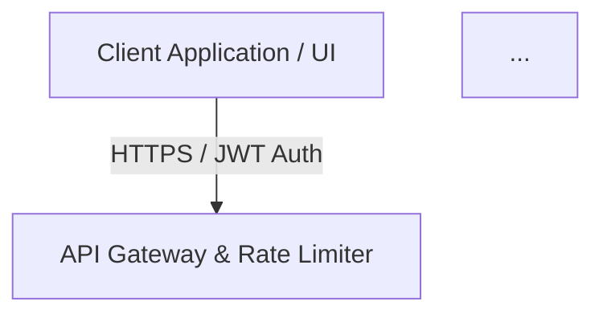

# Tutorial 4: System Design and STAR Mastery — The Full Interview Repertoire

> Who this is for: engineers who can build RAG pipelines (Tutorials 1-3) and now need
> to *narrate* a production architecture under time pressure, then survive the
> behavioral round with disciplined STAR answers. Time budget: 90 minutes, of which
> 30 are spoken aloud.

## What you will master

1. The 45-minute system design frame interviewers implicitly score you against.
2. A complete worked answer for the flagship question: "Design a Clinical Analysis
   Copilot handling 10,000 requests/sec with zero PII leakage" — built directly on
   `docs/architecture.md`.
3. Capacity and cost arithmetic with the repo's cost helpers, so your estimates are
   numbers, not adjectives.
4. A timed STAR drill against the interactive mock interviewer (`make mock`).

## Step 1: Set up the environment

```bash
python -m venv .venv
source .venv/bin/activate        # Windows: .venv\Scripts\activate
pip install -e ".[dev]"
cat docs/architecture.md
```

Expected output: the mermaid diagram and heading of the architecture reference
(abridged here):

```text
# Enterprise AI Architecture & RAG Pipeline

> Visual reference for System Design interviews: End-to-End Healthcare RAG & MLOps Platform.



**Google Colab variant:** the architecture reading and cost arithmetic work in Colab
after the usual cell (`%cd /content/vecanova-ai-interview-prep` and
`!pip install -e ".[dev]"`). The mock interview drill (Step 6) is a terminal
experience — run it locally, or in Colab with the piped-input trick shown there.

## Step 2: Internalize the reference architecture

Read `docs/architecture.md` until you can redraw it from memory. It is a six-stage
pipeline; memorize the stages, not the boxes:

| Stage | Components in the diagram | One-line responsibility |
|---|---|---|
| 1. Edge | Client, API Gateway, rate limiter | Authenticate (JWT), throttle, shape traffic |
| 2. Protect | PII/PHI sanitizer (Presidio/regex) | Mask identifiers before any model sees text |
| 3. Orchestrate | LangGraph multi-agent DAG | Route tasks, hold state, call tools |
| 4. Retrieve | Hybrid retriever (dense + BM25), vector DB, cross-encoder reranker | Fetch and rank the few chunks that matter |
| 5. Generate + Guard | Foundation model (private VPC / SageMaker), output guardrails | Produce a grounded, policy-compliant response |
| 6. Observe | RAGAS evaluation, Langfuse tracing | Score quality, trace latency/cost, feed CI gates |

This table *is* your whiteboard skeleton. Every system design answer you give in this
domain should draw these six stages within the first five minutes, then deep-dive where
the interviewer pushes.

## Step 3: Requirements and capacity math (minutes 0-10 of the real interview)

State assumptions out loud, then pin them with arithmetic. The repo's cost helpers make
this exact:

```python
from interview_prep.cost import estimate_tokens, estimate_cost, monthly_projection

system_prompt = "System: You are a clinical decision-support assistant for hospital care teams. Answer from the provided context."
user_prompt = "Patient context: 67-year-old, systolic 182, anomaly score 1.73. Draft a care-team alert."
response_text = "Escalate to the on-call team; recheck blood pressure in 15 minutes; document in the EHR."

tokens_in = estimate_tokens(system_prompt) + estimate_tokens(user_prompt)
tokens_out = estimate_tokens(response_text)
print(tokens_in, tokens_out)

cost_per_request = estimate_cost(
    tokens_in=tokens_in,
    tokens_out=tokens_out,
    price_in_per_mtok=1.50,     # frontier managed API, USD per million tokens
    price_out_per_mtok=6.00,
)
print(cost_per_request)
print(monthly_projection(requests_per_day=50_000_000, cost_per_request=cost_per_request))
```

Expected output (token counts follow from the exact strings above at 4 characters per
token):

```text
50 22
0.000207
310500.0
```

Now say the numbers as the interviewer expects to hear them: 10,000 requests per second
at peak is 864 million requests per day if sustained; even at a more realistic 50
million requests per day average, a frontier managed API at $0.000207 per request costs
about $310,500 per month. Halve the tokens and you halve the bill; switch to a smaller
model at one-tenth the price and the projection drops to roughly $31,050 — that
ratio is the entire managed-API-versus-self-hosted trade-off, quantified in one line.

## Step 4: The worked answer (minutes 10-35)

Deliver it in this order. Bracketed stage numbers reference the Step 2 table.

**Frame (30 seconds).** "I will confirm requirements, size the system, sketch the
high-level pipeline, then deep-dive retrieval, PII handling, and failure modes."

**Requirements (2 minutes).** Functional: clinicians ask questions over clinical notes
and get grounded, cited answers with care-team alerts. Non-functional: zero PII
egress (HIPAA), p95 latency under 2 seconds end to end, 99.9% availability, full audit
trail for seven years.

**High-level (5 minutes).** Draw the six stages. Name each component and its contract:
the gateway terminates JWT auth and rate limits [1]; the sanitizer masks identifiers
before anything leaves the trust boundary [2]; LangGraph owns routing and state [3];
hybrid retrieval combines dense embeddings with BM25 and a cross-encoder reranker [4];
the generation stage runs inside a private VPC with output guardrails [5]; RAGAS-style
evaluation and tracing close the loop [6].

**Deep dive 1 — hybrid retrieval (5 minutes).** Dense retrieval covers paraphrases;
BM25 covers exact identifiers (drug names, ICD-10 codes); reciprocal rank fusion
(k=60) merges the lists so a document missed by one channel still surfaces via the
other; the cross-encoder reranks the fused top-20 down to the top-5 chunks that fit the
context budget. Cite Tutorial 2 as your working implementation.

**Deep dive 2 — PII and compliance (5 minutes).** Sanitization is fail-closed and sits
on both the inbound prompt and the outbound response; the regex layer is deterministic
and auditable, and entity-recognizer tooling catches what patterns miss; every prompt
and response is logged in masked form. Zero leakage is a property of the pipeline
boundary, not of the model's good behavior.

**Deep dive 3 — state and failure modes (5 minutes).** LangGraph checkpoints agent
state per step, so a failed generation step resumes without re-retrieving. Failure
modes to volunteer: vector DB outage (degrade to BM25-only retrieval and flag answers
as lower confidence), reranker timeout (skip rerank, keep latency SLA), sanitizer
failure (reject the request — never bypass), model latency spike (circuit-break to a
smaller model).

**Trade-offs and wrap (5 minutes).** Managed API vs private VPC hosting (Step 3's cost
math), sync vs async for long analysis jobs, chunk size vs recall. Close by naming the
first thing you would build and the metric that proves it works — retrieval hit rate
and faithfulness, both measurable with Tutorial 2's gate.

## Step 5: The one-paragraph version (memorize this)

"When designing production GenAI platforms I implement a six-stage pipeline: edge auth
and rate limiting, deterministic PII sanitization before any model call, a LangGraph
orchestrator with checkpointed state, hybrid retrieval fusing dense embeddings with
BM25 and a cross-encoder reranker, generation inside a private VPC with output
guardrails, and RAGAS-style evaluation with tracing as a CI gate. Sizing is arithmetic,
not adjectives: at 50 million requests per day and 72 tokens per request, a frontier
API runs about $310,500 per month, which is why the cost projection belongs in the
design review, and why the fallback path — BM25-only retrieval, smaller model — is
designed before launch, not after the first incident."

## Step 6: Timed STAR drill with the mock interviewer

The behavioral round is a different muscle. Run the repo's interactive mock
interviewer, which draws from the packaged question bank and grades against a rubric:

```bash
make mock
```

(Exactly: `python scripts/interactive_interviewer.py --topic system_design`. Filter
with `--topic system_design|llmops|ml_core|behavioral`, `--difficulty mid|senior`, and
`--count 1-10` for a longer session.)

Expected output (the question is sampled at random from the bank, so yours will likely
differ; type an outline, press Enter, and the grading rubric prints — panel borders
trimmed here):

```text
VECANOVA AI Interview Simulator

SYSTEM_DESIGN - senior - saas
Design a semantic cache that can never serve stale or wrong-tenant answers.

Outline your answer, then press Enter for the rubric:

Grading rubric
1. Cache key: normalized query + tenant ID + model/prompt version
2. Similarity threshold trade-off: hit rate vs wrong-answer risk
3. TTL tied to content freshness per knowledge domain
4. Measure hit rate and p50 latency delta before/after rollout

Session complete. Grade yourself against the rubric.
```

Now run the drill against the printed question with a timer set to **90 seconds**:

- **Situation (15s).** Global consulting team building a clinical data copilot for
  hospital clients; notes flowed to an LLM with no masking, and compliance blocked the
  release.
- **Task (15s).** Ship a zero-PII-leakage copilot at 10,000 requests/sec peak without
  pushing p95 latency past 2 seconds.
- **Action (45s).** Deliver the six-stage pipeline from Step 4, compressed: sanitizer
  at the boundary, hybrid retrieval with RRF, LangGraph checkpointed state, private-VPC
  generation, RAGAS gate in CI.
- **Result (15s).** Production release with 99.8% PII masking compliance on audited
  traffic, p95 latency cut by 40% after the reranker budget, and evaluation gates
  preventing two hallucination regressions from shipping.

Score yourself after each pass: 1 point per quadrant completed inside its budget, 1
point per printed rubric line you actually covered, and 1 point if every claim carried
a number. Below the bar means trim the Situation and Task to buy Action time — that is
where senior candidates win the round.

## What you learned

- A system design answer is a timed, ordered narrative: frame, requirements,
  high-level, deep dives, trade-offs — not a stream-of-consciousness tour.
- The six-stage architecture table from `docs/architecture.md` is your reusable
  whiteboard skeleton for any healthcare/RAG design question.
- Capacity and cost are one-liners with `estimate_tokens`, `estimate_cost` and
  `monthly_projection`; numbers convert trade-offs into decisions.
- STAR answers are budgeted at 90 seconds with the Action quadrant taking half, and
  every Result carries a metric.

## Exercises

### Exercise 1: The 90-second repeat

Set a 90-second timer and deliver the STAR answer aloud twice. First pass: record it.
Second pass: cut every sentence that is not Situation, Task, Action or Result.

<details>
<summary>Solution</summary>

Score the second pass with the rubric from Step 6 (quadrant budgets plus the
numbers-claim point). The most common failure is a 40-second Situation; the fix is
brutal: "Clinical copilot for hospital clients. Compliance blocked release over PII
leakage." — twelve words, done. If you cannot finish Action in 45 seconds, you are
describing the pipeline instead of narrating decisions; drop component names you cannot
defend and keep the six-stage skeleton. Repeat until you hit the bar three times in a
row; then run the interviewer with
`python scripts/interactive_interviewer.py --topic behavioral` the same way.
</details>

### Exercise 2: Whiteboard from memory

On paper, redraw the full pipeline from `docs/architecture.md` in under 10 minutes
without peeking, then diff against the mermaid diagram.

<details>
<summary>Solution</summary>

Your drawing must contain, in order: client, gateway with rate limiter, sanitizer,
LangGraph orchestrator, traditional ML engine, hybrid retriever, vector DB, reranker,
foundation model, output guardrails, RAGAS/Langfuse observability. The most commonly
forgotten nodes are the reranker (between retrieval and generation) and the feedback
edge from observability back to the client. If you missed either, redo the drawing
tomorrow — spaced repetition beats one long session.
</details>

### Exercise 3: Price the growth story

The customer doubles traffic to 100 million requests per day and asks for a bigger
model that costs double per million tokens. Compute the new monthly projection and
write the two-sentence recommendation you would give the customer.

<details>
<summary>Solution</summary>

```python
from interview_prep.cost import estimate_cost, monthly_projection

bigger = estimate_cost(tokens_in=50, tokens_out=22,
                       price_in_per_mtok=3.00, price_out_per_mtok=12.00)
print(bigger)
print(monthly_projection(requests_per_day=100_000_000, cost_per_request=bigger))
```

Output:

```text
0.000414
1242000.0
```

Doubling volume *and* doubling both unit prices quadruples the bill: about $1,242,000
per month. The two-sentence recommendation: "At this volume a managed frontier API
costs roughly $1.24M per month; a self-hosted mid-size model on dedicated capacity runs
an order of magnitude less at comparable faithfulness on our eval suite. I recommend
piloting the hosted model against the Tutorial 2 evaluation gate before committing." —
price first, quality evidence second, decision framed as a measured pilot.
</details>

## Interview lens

System design interviewers score structure under pressure; behavioral interviewers
score evidence under pressure. Your edge is that both now run on the same artifact:
the six-stage pipeline is the system design answer *and* the Action quadrant of the
STAR story. Volunteer the cost projection before the interviewer asks — candidates who
connect architecture to unit economics get escalated to the hiring-committee read as
"senior". In the behavioral round, the strongest differentiator is a Result with three
numbers (compliance rate, latency delta, regressions caught); rehearse until those
numbers are reflexes, because a stalled "umm" while retrieving a metric costs more
credibility than a modest number delivered instantly.

## Common errors

- `make mock` appears to hang — it is waiting for your typed answer at the
  `Outline your answer, then press Enter for the rubric` prompt. Press Enter to
  continue, or pipe it non-interactively: `echo "" | make mock` (and
  `!echo "" | make mock` in Colab).
- `ModuleNotFoundError: No module named 'typer'` when running the interviewer directly —
  dev dependencies not installed; run `pip install -e ".[dev]"` (or `make install`).
- `make: pytest: No such file` or missing `ruff` — same cause: the `.[dev]` extra was
  skipped during install.
- An unknown `--topic` value prints the valid topic list and exits with code 1 — valid
  topics are `system_design`, `llmops`, `ml_core` and `behavioral`.
- `FileNotFoundError` mentioning `data/questions.json` — your checkout predates the
  packaged question bank; pull the latest branch and re-run `pip install -e ".[dev]"`.
- Panel borders look broken or wrapped oddly in your terminal — the `rich` console
  adapts to terminal width; resize the window or pipe to a file to see the plain text.
- The mock question differs from this tutorial's transcript — the interviewer picks at
  random from the topic bank; the drill method is identical.
- Wrong numbers in the cost block — you edited the prompt strings; token counts follow
  from the exact strings (about 4 characters per token), so changed strings change
  `tokens_in`/`tokens_out` and every downstream projection.
- Colab: the interactive input prompt raises `StdinNotImplementedError` — that is the
  piped-input case again: `!echo "" | make mock`.
